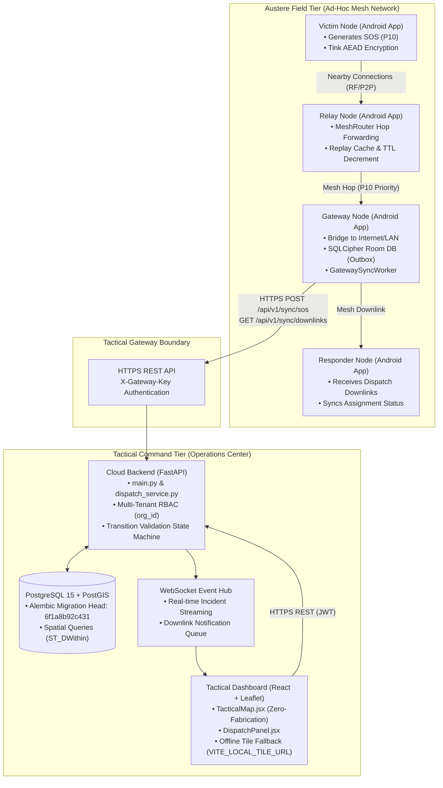
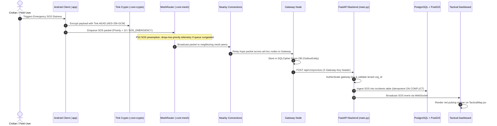
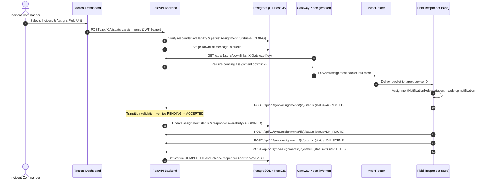

# Nexus Support — System Architecture Specification

## 1. Executive Summary

Nexus Support is an offline-first emergency mesh communication and incident coordination platform designed for disaster response operations where municipal telecommunications, cellular base stations, and internet infrastructure are degraded or non-existent.

The platform provides a resilient dual-tier architecture:
1. **Austere Edge Tier**: Mobile devices form an ad-hoc peer-to-peer mesh network over wireless transports (Google Nearby Connections BLE/Wi-Fi Direct) to route distress signals (SOS) and responder status messages locally with zero infrastructure dependency.
2. **Tactical Command Tier**: An optional, gateway-bridged operations center providing centralized spatial coordination (FastAPI, PostgreSQL/PostGIS, React, Leaflet) for incident commanders when upstream connectivity (satellite link, emergency cellular vehicle, local tactical LAN) is available.

---

## 2. End-to-End System Topology

---

## 3. Subsystem Breakdown & Component Responsibilities

### 3.1 Android Mobile Application (`app/` and `core/`)

The Android application is organized into modular Gradle modules following Clean Architecture and Separation of Concerns:

| Module | Exact Path | Responsibilities & Key Files |
| :--- | :--- | :--- |
| **`:app`** | `app/src/main/java/com/meshlink/app/` | • Presentation layer: Jetpack Compose, Material 3 UI screens (`ui/dashboard/`, `ui/chat/`, `ui/guide/`). • Background execution: `GatewaySyncWorker.kt` (outbox sync to cloud) and `CloudSyncWorker.kt`. • System notifications: `AssignmentNotificationHelper.kt` (Android 13+ `POST_NOTIFICATIONS` runtime check, high-importance heads-up channel). • Offline AI intelligence: `OfflineRagManager.kt` (MediaPipe GenAI on-device LLM with XML prompt fencing). |
| **`:core:mesh`** | `core/mesh/src/main/java/com/meshlink/app/mesh/` | • Mesh routing: `MeshRouter.kt` implements P10 SOS priority preemption, bounded outbox queues, TTL decrementing, and deduplication cache. • Transport abstraction: `MeshTransport.kt` defining connection contracts. • P2P transport: `NearbyConnectionsTransport.kt` wrapping Google Nearby Connections (`P2P_CLUSTER`). • Packet models: `MeshPacket.kt` wire structure. |
| **`:core:data`** | `core/data/src/main/java/com/meshlink/app/data/` | • Persistence: Room Database with SQLCipher 4.9.0 encryption (`DatabaseModule.kt`, `AppDatabase.kt`). • Transactional Outbox: `OutboxEntity.kt`, `OutboxDao.kt`, and `OutboxRepository.kt` for durable store-and-forward sync. • Cloud REST integration: `MeshBackendService.kt` and `NetworkModule.kt` (injects `BuildConfig.GATEWAY_KEY`). |
| **`:core:crypto`** | `core/crypto/src/main/java/com/meshlink/app/crypto/` | • Cryptographic operations: `TinkCryptoManager.kt` wrapping Google Tink AEAD (AES-GCM-256) and ECIES hybrid encryption. • Key management: Android Keystore key storage and derivation. |
| **`:core:domain`** | `core/domain/src/main/java/com/meshlink/app/domain/` | • Pure Kotlin domain contracts: `Incident.kt`, `Node.kt`, `Message.kt`, `Responder.kt`. • Validation contracts with zero Android framework dependencies. |

### 3.2 Cloud Backend Service (`cloud/backend/`)

Built with Python 3.11+, FastAPI, SQLAlchemy, and Alembic:
- **`main.py`**:
  - Application entrypoint and REST API definition.
  - Gateway sync endpoints: `POST /api/v1/sync/sos`, `GET /api/v1/sync/downlinks`, `POST /api/v1/sync/assignments/{assignment_id}/status`.
  - Dispatch endpoints: `POST /api/v1/dispatch/assignments`.
  - Diagnostics: `GET /health` reporting application version (`1.0.0`), database connection status, and Alembic migration head (`6f1a8b92c431`).
  - Production security: Refuses startup if default development key `meshlink_gw_dev_secret` is detected in non-development environments.
- **`app/services/dispatch_service.py`**:
  - Spatial responder indexing and proximity queries using PostGIS (`ST_DWithin`, `ST_MakePoint`).
  - Strict assignment transition validation state machine (`ALLOWED_ASSIGNMENT_TRANSITIONS`):
    `PENDING` $\to$ `ACCEPTED` $\to$ `EN_ROUTE` $\to$ `ON_SCENE` $\to$ `COMPLETED` (or `CANCELLED`). Enforces HTTP 409 Conflict for invalid order, 404 for missing entities, and 403 for unauthorized tenants.
- **`alembic/`**:
  - Versioned migration files applying PostgreSQL and PostGIS DDL schemas cleanly.

### 3.3 Tactical Operations Dashboard (`cloud/frontend/`)

Built with React 18, Vite, TailwindCSS, Lucide-React, and React-Leaflet:
- **`src/components/TacticalMap.jsx`**:
  - Tactical mapping canvas with RF Mesh, Topo, and Satellite base layers.
  - **Zero-Fabrication Enforcement**: Validates coordinates for null and explicit (0,0); unmapped beacons are quarantined into an unmapped flyout drawer ("AWAITING GPS FIX") to prevent misleading search teams.
  - **Offline Tile Fallback**: Reads `VITE_LOCAL_TILE_URL`, supports local offline raster tile servers (`LOCAL OFFLINE` button), and displays status badge (`ONLINE TILES`, `OFFLINE TILES`, `NO MAP TILES`).
- **`src/components/DispatchPanel.jsx`**:
  - Tactical dispatch interface displaying real online field assets with battery, telemetry, and assignments. Shows explicit empty state when no assets are active.

---

## 4. End-to-End Data Flows

### 4.1 SOS Uplink Pipeline

### 4.2 Dispatch Assignment Downlink & Status Sync-Back Pipeline

---

## 5. Architectural Design Decisions & Trade-Off Analysis

### 5.1 Google Nearby Connections vs. Raw Wi-Fi Direct / Raw BLE
- **Decision**: Implemented `NearbyConnectionsTransport.kt` utilizing the Google Nearby Connections API with `Strategy.P2P_CLUSTER`.
- **Reasoning**: Raw Wi-Fi Direct on Android suffers from severe OEM fragmentation (Samsung, Xiaomi, and Google Pixel devices exhibit incompatible Group Owner negotiation behaviors and connection dropouts). Nearby Connections manages the underlying RF physical layer dynamically, utilizing BLE for continuous low-power discovery and automatically establishing Wi-Fi Direct or hotspot sockets when payload size requires higher bandwidth.
- **Alternatives Considered**: Raw Android Wi-Fi P2P (`WifiP2pManager`) and custom BLE GATT servers. Rejected due to high failure rate in automated multi-vendor device pairing.

### 5.2 Google Tink ECIES + AES-GCM-256 vs. Custom Cryptography
- **Decision**: Integrated Google Tink (`core/crypto/src/main/java/com/meshlink/app/crypto/TinkCryptoManager.kt`) utilizing ECIES with HKDF and AES-256-GCM envelope encryption.
- **Reasoning**: Cryptographic primitives must avoid common implementation vulnerabilities (such as nonce reuse in standard GCM, padding oracle attacks, or insecure key derivation). Google Tink provides safe-by-default, audited cryptographic envelopes.
- **Alternatives Considered**: Custom BouncyCastle RSA-2048 wrapper. Rejected due to excessive key and ciphertext overhead on low-MTU mesh transports, high memory footprint, and susceptibility to side-channel timing leaks.

### 5.3 SQLCipher 4.9.0 Encrypted Storage + Fail-Closed Policy
- **Decision**: Configured Android Room persistence with SQLCipher 4.9.0 256-bit AES full-database encryption backed by Android Keystore derived passphrases (`DatabaseModule.kt`).
- **Reasoning**: If a responder or civilian device is lost, confiscated, or captured in a conflict or disaster zone, plain SQLite databases expose the entire history of SOS locations, responder identities, and network routes. The application enforces a fail-closed policy: if key corruption is detected, the database does not decrypt insecurely.
- **Alternatives Considered**: Unencrypted Room database with `EncryptedSharedPreferences`. Rejected because tabular relational data and spatial indices cannot be safely or efficiently queried through key-value stores.

### 5.4 Transactional Outbox Pattern for Uplink Resilience
- **Decision**: Implemented an explicit `outbox` database entity (`core/data/.../OutboxEntity.kt`) and `GatewaySyncWorker.kt` running under Android `WorkManager`.
- **Reasoning**: Edge networks experience frequent, unpredictable disconnections. When an SOS or telemetry packet is generated, it is written atomically to the encrypted database outbox in the same transaction as local state. `WorkManager` delivers the payload with exponential backoff (2s to 30s) when network constraints are satisfied.
- **Alternatives Considered**: In-memory queuing or direct HTTP calls from ViewModels. Rejected because Android OS process termination during memory pressure would cause permanent loss of critical emergency beacons.

### 5.5 PostgreSQL + PostGIS Spatial Engine
- **Decision**: Deployed PostgreSQL 15 with PostGIS spatial extension (`Geometry(Point, 4326)`).
- **Reasoning**: Real-time tactical dispatch requires high-performance spatial queries (e.g. `ST_DWithin` to find all available medical responders within 5 km of an incoming flash flood SOS). PostGIS spatial indexing (R-Tree / GIST) executes these queries in sub-millisecond times, avoiding $O(N)$ linear in-memory loops.
- **Alternatives Considered**: Flat SQLite or MySQL with in-memory Haversine math. Rejected due to lack of spatial indexing, lock contention under concurrent gateway synchronization, and poor geospatial function support.

### 5.6 Multi-Tenant Organization Isolation
- **Decision**: Embedded `organization_id` (`org_id`) foreign key constraints across all incidents, assignments, responders, and gateway nodes in backend schemas, enforced via SQLAlchemy query scoping and JWT role verification.
- **Reasoning**: Emergency response frequently involves multiple distinct organizations (e.g., Red Cross, Local Fire Department, National Guard) operating on shared infrastructure during joint mutual-aid operations. Strict tenant isolation ensures organizations cannot view, alter, or dispatch each other's personnel without explicit mutual authorization.
- **Alternatives Considered**: Separate database per tenant. Rejected due to operational complexity and container overhead in austere, resource-constrained field deployments.
