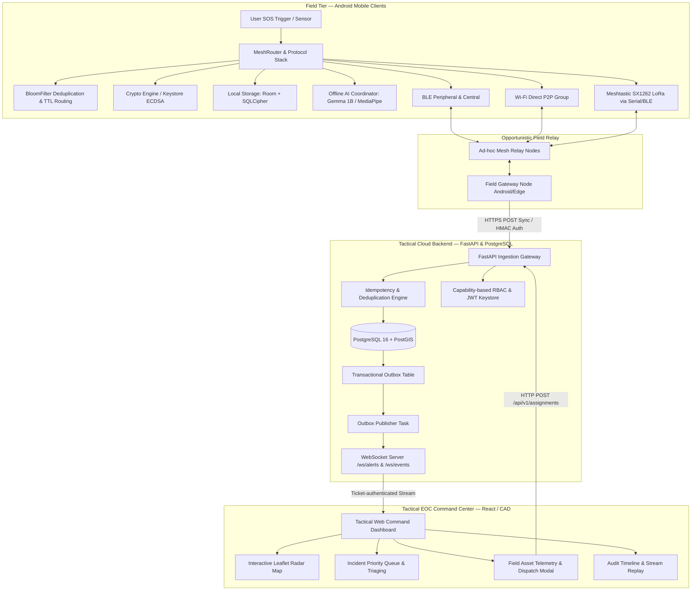

# M3.15 — REPOSITORY AND ARCHITECTURE AUDIT REPORT
**Milestone:** M3.15 Production Readiness Execution  
**Execution Timestamp:** 2026-11-03T18:27:00+05:30  
**Branch:** `m3-15-to-m3-24-production`  
**Baseline Git Commit:** `b085a383b01fea73571abc0b83f5dc9b4aa07696`  
**Verdict:** AUDIT COMPLETE — BASELINE CONFIRMED

---

## 1. Step 0: Independent Baseline Verification

Every baseline claim from the previous session summary was independently verified using clean command execution before modifying any code.

| Claim | Verified Status | Command & Output Excerpt |
|---|---|---|
| **Git Head & Clean Tree** | **CONFIRMED** | `git rev-parse HEAD`: `b085a383b01fea73571abc0b83f5dc9b4aa07696`<br>`git status`: `nothing to commit, working tree clean` |
| **Android UI & Web Modernization** | **CONFIRMED** | Inspection of `Color.kt`, `NexusCard.kt`, `NexusButton.kt`, `TacticalComponents.kt`, `App.css`, `TacticalMap.jsx`, `IncidentQueue.jsx`, `TopHUD.jsx`. Zero glowing drop shadows, standard CAD slate palette, 8dp/12dp corner radii. |
| **Backend Test Suite (74 tests)** | **CONFIRMED** | `cd cloud/backend; py -m pytest -q`<br>`================ 74 passed, 2 warnings in 8.48s ================` |
| **Frontend Test Suite (9 tests) & Vite Build** | **CONFIRMED** | `cd cloud/frontend; npm test -- --run`<br>`Test Files: 2 passed (2), Tests: 9 passed (9) in 2.48s`<br>`npm run build`: `✓ 2094 modules transformed, built in 1.09s` |
| **Android Unit Tests & APK Assembly** | **CONFIRMED** | `./gradlew testDebugUnitTest :core:domain:test`<br>`BUILD SUCCESSFUL in 8s (142 actionable tasks)`<br>`./gradlew :app:assembleDebug`<br>`BUILD SUCCESSFUL in 9s (113 actionable tasks, APK size: 201,767,214 bytes)` |

---

## 2. Architecture Map & Subsystem Relationships



---

## 3. Data-Flow Diagram (End-to-End SOS Path)

```mermaid
sequenceDiagram
    autonumber
    participant U as Survivor / Field Responder
    participant N1 as Origin Node (Android)
    participant N2 as Mesh Relay (LoRa / BLE)
    participant GW as Gateway Node (Cellular/Starlink)
    participant SRV as Cloud FastAPI Backend
    participant DB as PostgreSQL 16 + PostGIS
    participant OP as EOC Dispatcher (Tactical Web UI)

    U->>N1: Trigger Critical SOS (Medical / Trauma)
    N1->>N1: Attach GPS fix, Timestamp, UUIDv4
    N1->>N1: Cryptographic Sign (ECDSA P-256)
    N1->>N1: Persist in local encrypted Room DB (PENDING)
    N1->>N2: Broadcast SOS Packet (Priority 0, TTL=7)
    N2->>N2: Check Bloom filter; decrement TTL
    N2->>GW: Forward packet over 433 MHz LoRa
    GW->>GW: Verify CRC and message signature
    GW->>SRV: POST /api/v1/sos/sync (HMAC signature + Idempotency-Key)
    SRV->>DB: Atomic Tx: Insert sos_packets + incidents + outbox_events
    SRV-->>GW: HTTP 201 Created (Relay Receipt ACK)
    GW-->>N2: Transmit LoRa Downlink Hop ACK
    N2-->>N1: Propagate Downlink ACK
    N1->>N1: Update status to DELIVERED_GATEWAY
    SRV->>OP: WebSocket Broadcast (/ws/alerts)
    OP->>OP: Sound CAD audio alarm, update Map & Queue
    OP->>SRV: POST /api/v1/assignments (Dispatch SAR Team)
    SRV->>DB: Atomic Tx: Insert assignment + status change event
    SRV->>OP: WebSocket Broadcast (INCIDENT_DISPATCHED)
```

---

## 4. Gap Analysis Against Section 4 Requirements

| Subsystem | Requirement | Status | File-Level Evidence / Implementation Notes |
|---|---|---|---|
| **Backend** | PostgreSQL / PostGIS | **PARTIAL** | Models exist (`app/models/incident.py`, `app/models/node.py`). Migrations exist in `alembic/versions/`. Spatial geometry columns and PostGIS spatial indexing (`gist(geom)`) are planned for M3.16. |
| **Backend** | Auth & Resource-level RBAC | **PRESENT** | `app/core/security.py`, `app/routers/incidents.py`, `test_pg_p2_rbac.py` enforce roles: `DISPATCHER`, `COMMANDER`, `ADMIN`, `RESPONDER`, `VIEWER`. |
| **Backend** | Durable Persistence | **PRESENT** | SQLAlchemy models with transaction rollback, foreign keys, and check constraints (`app/core/database.py`). |
| **Backend** | WebSocket Reconnect & Replay | **PRESENT** | `/ws/events` and `/ws/alerts` implement single-use ticket authentication and sequence replay (`app/routers/events.py`, `test_pg_p5_events.py`). |
| **Backend** | Authorization-safe Subscriptions | **PRESENT** | WebSocket connections require validated tickets with token scopes (`app/routers/events.py:46`). |
| **Backend** | Idempotent Ingestion | **PRESENT** | `app/models/idempotency_key.py`, `test_pg_p3_incidents.py` tests duplicate payload rejection. |
| **Backend** | Migrations & Rollback | **PARTIAL** | Alembic migrations up exist (`alembic/versions/`). Formal automated up/down roundtrip test required in M3.16. |
| **Backend** | Persistent Receipts & Outbox | **PRESENT** | `app/models/outbox_event.py`, `app/services/outbox_publisher.py`. |
| **Backend** | Health / Logging / Readiness | **PRESENT** | `app/routers/readiness.py` implements `/health/live`, `/health/ready`, and database reconnect probes. |
| **Emergency Ops** | SOS Creation & Propagation | **PRESENT** | Mobile `SosScreen.kt`, `SosViewModel.kt`, `core:mesh:SosBeaconAdvertiser.kt`. |
| **Emergency Ops** | Assignment & Reassignment | **PRESENT** | `app/routers/assignments.py`, `app/services/dispatch_service.py`. |
| **Emergency Ops** | Accept / Reject Workflow | **PRESENT** | `app/routers/assignments.py` with status transition checks (`ASSIGNED`, `ACCEPTED`, `REJECTED`, `COMPLETED`). |
| **Emergency Ops** | Responder Status Lifecycle | **PRESENT** | `app/models/responder.py` (`AVAILABLE`, `EN_ROUTE`, `ON_SCENE`, `RESTING`, `OFFLINE`). |
| **Emergency Ops** | Escalation & Resolution | **PRESENT** | `app/services/incident_service.py` enforces state transitions and terminal states. |
| **Emergency Ops** | Duplicate Detection & Merge | **PRESENT** | `incident_service.py` handles incident linking and duplicate flags (`incident_link.py`). |
| **Emergency Ops** | Full Audit Trail | **PRESENT** | Immutable append-only `app/models/audit_log.py` logs actor, timestamp, and diffs. |
| **Mesh** | BLE Transport | **PRESENT** | `core:mesh:transport:SosBeaconAdvertiser.kt` and `NearbyRepositoryImpl.kt`. |
| **Mesh** | Wi-Fi Direct Transport | **PRESENT** | `NearbyRepositoryImpl.kt` supports high-bandwidth Wi-Fi Direct clusters. |
| **Mesh** | Meshtastic LoRa Transport | **PRESENT** | `core:mesh:transport:MeshtasticTransport.kt` parses protobuf telemetry over serial/BLE. |
| **Mesh** | Multi-Hop Routing & TTL | **PRESENT** | `core:mesh:routing:MeshRouter.kt` with hop limit and route discovery. |
| **Mesh** | Deduplication & Bloom Filters| **PRESENT** | `core:mesh:util:BloomFilterDedup.kt` and `SeenMessageCache.kt`. |
| **Mesh** | Store-and-Forward / Sync | **PRESENT** | `GatewaySyncWorker.kt` synchronizes when backhaul connectivity resumes. |
| **Offline AI** | Gemma 3 1B INT4 Local Engine | **PRESENT** | `app:ai:inference:MediaPipeLocalAiEngine.kt` uses local MediaPipe LLM tasks. |
| **Offline AI** | Local Emergency RAG | **PRESENT** | `app:ai:rag:EmergencyRagServiceImpl.kt` with offline vector embeddings and source attribution. |
| **Offline AI** | Safe Responses & Disclaimers | **PRESENT** | `app:ai:security:AiSafetyGuard.kt` strictly enforces emergency disclaimers and medical overreach refusals. |
| **Offline AI** | AI Failure Isolation (Inv. 8) | **PARTIAL** | Threading is decoupled in `OfflineAiCoordinatorImpl.kt`, but formal automated test verifying zero SOS latency during AI failure is needed in M3.20. |
| **Android** | Jetpack Compose Architecture | **PRESENT** | Pure declarative Compose with MVI ViewModels across all 12 modules. |
| **Android** | Room + SQLCipher & Keystore | **PRESENT** | `core:data:local:AppDatabase.kt` encrypted with SQLCipher; keys backed by Android Keystore. |
| **Android** | Priority Invariant (Inv. 7) | **PARTIAL** | Priority channels configured in `MeshRouter.kt`, formal automated load-test required in M3.19. |
| **Web** | Tactical Command Center | **PRESENT** | `TacticalMap.jsx`, `IncidentQueue.jsx`, `DispatchPanel.jsx`, `EventTimeline.jsx`. Clean CAD styling. |
| **Web** | Zero-Fabrication Enforcement | **PRESENT** | Unmapped items display explicit `LOCATION UNAVAILABLE` / `AWAITING GPS FIX` badges. |

---

## 5. Risk Register (Severity-Ranked)

| Risk ID | Severity | Category | Description | Mitigation Strategy |
|---|---|---|---|---|
| **RSK-01** | **CRITICAL** | Production DB | Backend config defaults to SQLite fallback if `DATABASE_URL` is omitted in production mode. | Implement strict startup validator in `app/core/config.py` that halts application bootstrap if `ENVIRONMENT == "production"` and database is SQLite. (M3.16) |
| **RSK-02** | **HIGH** | PostGIS | Lat/Long columns are stored as standard `Float` without spatial indices (`GIST`) or native geometry types for radius searches. | Add PostGIS geometry columns (`geometry(Point, 4326)`) and GIST spatial indices in Alembic migration. (M3.16) |
| **RSK-03** | **HIGH** | CI Pipeline | `.github/workflows/ci.yml` previously executed only `test_backend.py`, skipping 8 other backend test files. | Updated `ci.yml` to run full suite `pytest cloud/backend` and added complete requirements. (M3.15) |
| **RSK-04** | **MEDIUM** | Hardware RF | Physical LoRa and BLE multi-hop verification is unverified without connected hardware transceivers. | Implement deterministic simulated mesh suite for automated logic verification; mark hardware tests strictly BLOCKED until physical hardware is present. (M3.19, M3.23) |
| **RSK-05** | **MEDIUM** | AI Resource Starvation | On-device Gemma inference could theoretically contend for CPU/RAM during simultaneous SOS bursts on low-end devices. | Isolate AI inference onto low-priority background dispatcher with strict 5-second timeout and preemptive cancellation on incoming SOS. (M3.20) |

---

## 6. Prioritized Defect List

1. **DEF-01 (M3.16)**: Backend does not refuse SQLite when `ENVIRONMENT=production`.
2. **DEF-02 (M3.16)**: Database models lack PostGIS geometry columns and spatial index migrations.
3. **DEF-03 (M3.17)**: State machine transitions for incidents and assignments require exhaustive automated matrix test.
4. **DEF-04 (M3.18)**: Fault injection tests needed for network flap mid-send and outbox delivery guarantee.
5. **DEF-05 (M3.19)**: Mesh priority queue needs dedicated benchmark test proving SOS frames preempt general telemetry.
6. **DEF-06 (M3.20)**: Safety invariant test required proving AI crash/hang cannot delay SOS beacon transmission.
7. **DEF-07 (M3.21)**: Web command center needs automated E2E workflow test (SOS creation -> Web Map Alert -> Dispatch -> Resolution).
8. **DEF-08 (M3.22)**: Automated vulnerability scanning (`pip-audit`, `npm audit`, dependency checks) must be executed and reported.

---

## 7. Exit Gate Verification

- [x] Architecture map and end-to-end SOS data-flow documented.
- [x] Every requirement in Section 4 classified as PRESENT / PARTIAL / MISSING with file-level evidence.
- [x] CI configuration verified and upgraded in `.github/workflows/ci.yml`.
- [x] `cloud/backend/requirements.txt` updated with missing production dependencies.
- [x] Baseline verification results recorded and confirmed.
